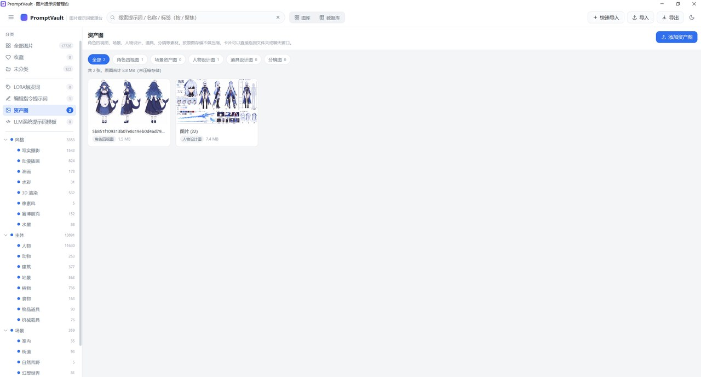

# PromptVault · 图片提示词管理台

一个**完全离线**的本地图片提示词（Prompt）管理工具。纯原生 HTML + CSS + ES Module，
**零框架、零构建、零 npm 依赖、零 CDN 外链**，所有数据存在浏览器 IndexedDB 里，一个字节都不上传。

> 适合管理 AI 出图（Stable Diffusion / Midjourney / 即梦 / 可灵等）产生的图片与提示词。
> 支持从 Word 文档批量导入「图片 + 提示词」，并自动按提示词内容推断分类。


---

## 目录

- [为什么做这个](#为什么做这个)
- [功能](#功能)
- [快速开始](#快速开始)
- [五大模块](#五大模块)
- [导入方式](#导入方式)
- [自动分类](#自动分类)
- [去重与清理](#去重与清理)
- [数据与隐私](#数据与隐私)
- [提示词配对文件](#提示词配对文件)
- [数据模型](#数据模型)
- [目录结构](#目录结构)
- [桌面版](#桌面版)
- [技术说明](#技术说明)
- [浏览器要求](#浏览器要求)
- [开发](#开发)
- [License](#license)

---

## 为什么做这个

AI 出图的人手里通常有几万张图和对应提示词，散落在各种地方：

- 提示词记在 Word 文档里，图另存一份，**找图时对不上哪句提示词是它的**
- 文件夹按日期堆，想找「上次那个赛博朋克风格的少女」只能一张张翻
- 想把某条提示词改改复用，得先打开那个 Word 文档，再翻到第 87 页
- 用过的图库工具要么要联网、要么要登录、要么把图压得没法看

PromptVault 解决的就一件事：**把「图」和「提示词」绑在一起，本地存、本地搜、一键复制**。

---

## 功能

### 图库

- **真分页** —— 每页 60 张，上万张也不卡；底栏可翻页、可输页码跳转
- 响应式网格，悬停 250ms 弹出提示词气泡（正向 / 负向 / 标签），气泡里直接复制
- 卡片快捷操作：收藏、复制正向提示词、打开详情
- 左栏两级分类树，带实时数量

### 详情弹窗

- 大图预览，`←` / `→` 切上一张 / 下一张
- 分类、标签、正向 / 负向提示词、备注全部可编辑，**失焦 400ms 自动保存**
- 一键复制完整提示词（正向 + 负向 + 参数）

### 数据库视图

- 完整表格，点击表头排序，**双击单元格行内编辑**
- 多选批量改分类 / 删收藏 / 删除
- 独立分页与筛选，不影响图库

### 导入

- **Word 文档**（`.docx`）—— 自动识别「图片 + 紧随其后的提示词」，支持多文档批量导入
- **普通图片** —— 拖拽、多选、整个文件夹递归
- **快速导入** —— 粘贴剪贴板里的图，填提示词，一步入库
- **PNG 内嵌提示词** —— 自动读取 AI 工具写进 PNG 的生成参数
- **配对文件** —— 同名 `.txt` / `.json` 自动关联

### 其他

- 导出：全库 JSON（含图片）、仅元数据 JSON、CSV、当前筛选结果、选中项
- 深 / 浅双主题
- 全局搜索（名称 / 正向 / 负向 / 备注 / 标签，空格分隔表示「同时包含」）
- 导入时按提示词自动推断分类（可关）

---

## 快速开始

> ⚠️ 浏览器对 `file://` 下的 ES Module 有 CORS 限制，**必须通过本地 HTTP 服务打开**，不能直接双击 `index.html`。

### Windows

双击 `start.bat`，脚本自动选 Python 或 Node 起服务，并打开浏览器访问 <http://localhost:8899/>。
**关闭那个命令行窗口即停止服务。**

### macOS / Linux

```bash
chmod +x start.sh
./start.sh
```

### 手动启动（任选其一）

```bash
python -m http.server 8899
# 或
npx --yes serve -l 8899 .
```

然后浏览器访问 <http://localhost:8899/>。

> 不想装 Python / Node，也不想开命令行？用 [桌面版](#桌面版)，双击 exe 就能用。

---

## 五大模块

左栏除了分类树，还有四个独立模块，分别管不同类型的素材：

| 模块 | 存什么 | 特点 |
| --- | --- | --- |
| **图库** | 带提示词的成品图 | 压缩到 300KB 内入库，保留缩略图 |
| **LORA 触发词** | 本地 loras 目录的触发词 | 映射目录，只读文件名不读权重；句柄存 IndexedDB，下次免选 |
| **编辑指令提示词** | 图生图 / 局部重绘指令 | 可选配「原图 + 编辑后」对比图 |
| **资产图** | 角色四视图 / 场景 / 道具 / 分镜 | **原图存储，不压缩**；可拖到资源管理器或聊天窗口 |
| **LLM 系统提示词模板** | system prompt 纯文本 | 存角色设定、输出格式约束这类长期复用的指令 |



### 键盘快捷键

| 快捷键 | 作用 |
| --- | --- |
| `/` 或 `Ctrl+F` | 聚焦搜索框 |
| `Esc` | 关闭当前弹窗 |
| `←` / `→` | 详情弹窗切上一张 / 下一张 |
| `Ctrl+A` | 数据库视图全选当前页 |

---

## 导入方式

导入入口一共四个：Word 文档、普通图片、快速导入、PNG 内嵌。
分类那一栏默认开着自动推断，不选也能导 —— 推断不出来才用左栏当前筛选兜底。

<p align="center"></p>

### 1. Word 文档导入（推荐批量用）

点「导入」→「选择 Word 文档」，**可以一次选多个** `.docx`。

解析逻辑（零依赖手写 ZIP + XML 解析）：

1. `.docx` 本质是 ZIP，正文在 `word/document.xml`，图片在 `word/media/`
2. 按段落顺序扫描，**图片和提示词在同一个段落时也能正确拆分**（Word 里插图后紧跟着打字，这两者会落在同一个 `<w:p>` 里）
3. 图片后紧跟的文本段落作为该图的提示词
4. 结尾的链接 / 推广段落自动跳过，不会混进最后一张图的提示词

导入前会弹出预览列表，**每行显示缩略图、提示词、自动推断的分类**，可以逐条改分类、逐条勾选。
上万条时分页渲染（首屏 200 行），不会卡死。

### 2. 普通图片导入

- 拖拽到窗口任意位置
- 点「导入」选文件（可多选）
- 选整个文件夹（递归子目录）

同目录下的同名 `.txt` / `.json` 会被自动配对成提示词。

### 3. 快速导入

点顶栏「快速导入」，把图粘贴进去（`Ctrl+V`），填提示词，回车入库。
适合一条一条整理素材的场景。

### 4. PNG 内嵌提示词

很多 AI 出图工具会把生成参数写进 PNG 的 `tEXt` / `zTXt` / `iTXt` 文本块。
本工具会流式读取这些块，自动提取正向 / 负向提示词和采样参数，**导入即带词**。

---

## 自动分类

导入时，如果提示词里能看出内容，会自动推断一级 + 二级分类，不用手动归类。

### 优先级

```
用户手动改过下拉  >  配对 JSON 里的分类  >  自动推断  >  左栏筛选预填兜底
```

- 你在导入弹窗里**手动选了分类**，就以你的为准，推断完全不参与
- 没选，就按提示词推断
- 推断不出来，才回落到左栏当前筛选的分类
- 导入弹窗里有开关，可以整体关掉

### 打分规则

1. 22 条规则，对应 22 个二级分类，每条配一组中英文关键词
2. 命中数 = 该分类命中的**不同关键词**个数（同一个词只算一次）
3. 得分 = 命中数 × 一级分类权重（风格 1.25 / 主体 1.25 / 场景 1.10）
4. 汉字数 ≥3 的长词每个额外 +0.15（最多 3 个），让更具体的词赢下歧义
5. 取最高分；平分时按 风格 > 主体 > 场景 → 命中数 → 分类排序 → 名称
6. 一个关键词都没命中就返回「未分类」，**不瞎猜**

### 几个细节

- **英文走词边界匹配**：`cat` 不会命中 `delicate`，`iso` 不会命中 `isometric`
- **长词优先去重**：命中「塔楼」时不再重复计「楼」
- **跨分类单字吸收**：单字词被别的分类里命中的更长整词包含时不计分 —— 「树蛙」不会因为含「树」被判成植物，「马路」不会因为含「马」被判成动物
- **成语排除**：「车水马龙」「腾云驾雾」「水龙头」这类成语先整段剔除再匹配，不会因为含「马」「龙」被判成动物
- **分类名容错**：你改过分类名、加过新分类、删过分类都不会报错，找不到对应分类的规则直接跳过

> 自动分类只是**减少手工归类的工作量**，不是替代你判断。判错了在预览列表里下拉改一下就行。

---

## 去重与清理

### 导入时去重

每张图入库前算 SHA-256（对**原始文件**算，不是压缩后的），与库中已有记录比对：

- **普通导入**：发现重复会弹窗问你「全部跳过 / 全部覆盖 / 全部保留两份」，本次导入剩余重复项统一按此处理
- **Word / 批量导入**：静默跳过，结束时 toast 告诉你「新增 N 张，跳过重复 M 张」

### 剔除已有重复

图库顶栏有「**剔除重复图片**」按钮，用来清理历史遗留的重复（比如以前选了「保留两份」留下的）。

按内容指纹分组，**每组保留一张**，取舍顺序：

1. 信息完整度（有提示词 > 有分类 > 收藏 > 有标签 / 备注）
2. 创建时间更早的
3. id 字典序（保证每次扫描结果稳定）

点击后先弹窗告诉你「发现 N 组重复，共 M 张多余」，确认后才删。**不可撤销。**

> 只按 SHA-256 比对。没有指纹的老数据会跳过并提示数量 —— 不用「大小 + 尺寸」这种粗略匹配兜底，避免误删同批次生成的相似图。

---

## 数据与隐私

- 所有数据存在浏览器 **IndexedDB**（数据库名 `promptvault`）
- **不联网、不上传、不统计、不埋点**，没有一行外部请求
- 图片压缩和缩略图生成全部在本地 canvas 完成
- 哈希用浏览器内置 `crypto.subtle`，缺失时回退到内置实现

### 数据存在哪

| 打开方式 | 数据位置 |
| --- | --- |
| `localhost:8899` | 该浏览器该端口的 IndexedDB |
| 换个端口 | **另一套独立数据**（IndexedDB 按 origin 隔离） |
| 换浏览器 | 另一套独立数据 |

**换端口或换浏览器看不到原来的数据**，这是浏览器的安全隔离，不是 bug。
长期使用建议固定一个端口，并定期用「导出 → 全库 JSON」备份。

### 降级

如果 IndexedDB 不可用（比如直接 `file://` 打开被拦截），页面顶部会出现黄色警告条，
程序自动降级为**内存态**：功能都能用，但**关闭页面数据就没了**。

---

## 提示词配对文件

导入图片时，同目录下的同名文件会被自动识别：

| 文件 | 作用 |
| --- | --- |
| `xxx.txt` | 内容作为正向提示词 |
| `xxx-neg.txt` / `xxx_negative.txt` | 内容作为负向提示词 |
| `xxx.json` | 结构化字段，见下 |

`xxx.json` 支持的字段：

```json
{
  "prompt": "正向提示词",
  "positive": "正向提示词（与 prompt 二选一）",
  "negative_prompt": "负向提示词",
  "negative": "负向提示词（与 negative_prompt 二选一）",
  "tags": ["标签1", "标签2"],
  "category": "风格",
  "subCategory": "写实摄影",
  "params": "Steps: 30, CFG: 7"
}
```

### CSV 字段

```
name, category, subCategory, positive, negative, params, tags, favorite
```

- `tags` 用英文逗号或中文逗号分隔
- `favorite` 可写 `true` / `false` / `1` / `0` / `是` / `否`
- CSV **只还原元数据，不含图片本体**，导入后显示为占位卡片
- 分类按**名称**匹配，匹配不到就留空（不会自动新建分类，避免污染分类树）

---

## 数据模型

IndexedDB 数据库名 `promptvault`，版本 `3`，7 个对象仓库：

| 仓库 | 结构 |
| --- | --- |
| `categories` | `{ id, name, level(1\|2), parentId, order, color, createdAt }` |
| `images` | `{ id, name, blob, thumb, mime, width, height, size, positive, negative, params, categoryId, subCategoryId, tags[], favorite, note, hash, createdAt, updatedAt }` |
| `meta` | `{ key, value }` —— 设置、LORA 目录句柄等 |
| `loras` | `{ id, name, fileName, path, keywords, note, createdAt }` |
| `edits` | `{ id, title, content, before, after, tags[], note, createdAt }` |
| `assets` | `{ id, name, blob, mime, width, height, size, category, tags[], note, createdAt }` |
| `prompts` | `{ id, title, content, tags[], note, createdAt, updatedAt }` |

`images` 上建立了 `categoryId`、`subCategoryId`、`favorite`、`createdAt`、`hash` 五个索引。

### 种子分类

首次打开自动写入 **3 个一级 / 22 个二级分类**：

| 一级 | 二级 |
| --- | --- |
| **风格** | 写实摄影、动漫插画、油画、水彩、3D 渲染、像素风、赛博朋克、水墨 |
| **主体** | 人物、动物、建筑、地景、植物、食物、物品道具、机械载具 |
| **场景** | 室内、街道、自然荒野、幻想世界、太空、水下 |

> 早期版本还有「光照氛围 / 镜头构图 / 画质增强」三个维度，后来移除了。
> 原因：这三个描述的是**修饰手法**而非画面内容，几乎每条提示词都写「8K、bokeh、柔光、特写」，
> 在单选分类体系下必然被主体 / 风格压过（实测镜头构图命中率 0%、其余两个合计不到 13%），
> 留着只会让用户看到永远填不上的分类。老数据由一次性迁移自动清理，图片本身不丢。

---

## 目录结构

```
prompt-vault/
├─ index.html              页面骨架（顶栏 + 视图容器）
├─ package.json            仅用于 node --check 与静态托管，无任何依赖
├─ start.bat               Windows 一键启动
├─ start.sh                macOS / Linux 一键启动
├─ css/
│  └─ styles.css           全部样式（CSS 变量驱动的深浅双主题，约 1700 行）
├─ desktop/                Electron 桌面版（可选，见下方「桌面版」）
│  ├─ main.js              主进程：窗口、自定义 app:// 协议、单实例锁
│  ├─ preload.js           预加载脚本
│  ├─ scripts/
│  │  ├─ sync-renderer.mjs 把上级目录的网页版同步到 renderer/
│  │  └─ make-icon.py      纯 Python 标准库生成 .ico
│  └─ README.md            桌面版单独说明
└─ js/
   ├─ main.js              应用引导、顶栏、快捷键、拖拽、视图切换
   ├─ store.js             全局状态、筛选、分页、分类树、去重扫描、订阅广播
   ├─ db.js                IndexedDB 访问层（含内存降级实现、一次性迁移）
   ├─ utils.js             DOM / 图标 / 剪贴板 / 压缩 / 缩略图 / 哈希 / CSV / 弹窗 / toast
   ├─ png-meta.js          PNG 内嵌提示词提取（tEXt / zTXt / iTXt）
   ├─ docx-import.js       Word 解析与图文配对（手写 ZIP + XML，零依赖）
   ├─ auto-classify.js     按提示词文本推断分类（纯函数，可独立测试）
   └─ views/
      ├─ sidebar.js        左栏分类树与模块入口
      ├─ gallery.js        图库网格（分页 + 剔除重复）
      ├─ detail.js         详情弹窗
      ├─ manager.js        数据库表格视图
      ├─ transfer.js       导入 / 导出
      ├─ loras.js          LORA 触发词
      ├─ edits.js          编辑指令提示词
      ├─ assets.js         资产图
      └─ prompts.js        LLM 系统提示词模板
```

网页版约 11,000 行代码，零依赖。

---

## 桌面版

`desktop/` 是 Electron 封装，渲染层与网页版**共用同一套代码**（构建前自动同步，不改一行业务逻辑）。

适合不想装 Python / Node、也不想开命令行的场景：双击 exe 直接用。

### 自己打包

```bash
cd desktop
npm install
npm run build        # NSIS 安装包 + 便携版
# 或只打便携版
npm run build:portable
```

产物在 `desktop/dist/`。

### 开发模式

```bash
cd desktop
npm run dev
```

渲染层直接指向上一级目录，改完网页代码刷新窗口即可，不用重新同步。

### 数据不互通

桌面版的数据存在 Electron 的 `userData`（Windows 上是 `%APPDATA%\PromptVault\`），
和浏览器版是两套独立存储。迁移要走「导出整库 JSON → 桌面版导入」。

细节见 [`desktop/README.md`](desktop/README.md)。

---

## 技术说明

### 为什么不用框架

单文件 ES Module + 手写 DOM 构造（`el()` / `icon()`）就够用了。不引入 React / Vue 的好处：

- **打开就能用**：没有 `npm install`、没有构建步骤、没有 node_modules
- **十年后还能跑**：只要浏览器支持 ES Module
- **改一行就是改一行**：不用等热更新，刷新即可

代价是状态管理得自己写 —— `store.js` 用单向数据流 + 订阅广播（`emit(reason)`）解决。

### 几个值得说的实现

**图片压缩（`utils.js`）**
不是简单的「降到某个尺寸」，而是：

1. 超过 220 万像素的图**先缩分辨率再编码**（4000×3000 从 8.3 秒降到 0.55 秒）
2. 按「原图字节 / 像素」预判质量起点，命中即停，不做二分找最优
3. 压缩图和缩略图**共用同一次解码**
4. 并发 4 路（保守值，照顾低配机器；高于物理核数会互相抢占反而更慢）

**Word 解析（`docx-import.js`）**
手写 ZIP 中央目录解析 + `DOMParser` 解析 `document.xml`。
关键坑：**Word 里图片和提示词常常在同一个 `<w:p>` 段落里**（插图后直接打字），
所以不能「段落有图就整段当图片」，必须按 run 顺序拆分。

**自动分类（`auto-classify.js`）**
纯函数，不依赖 DOM 和全局状态，可以直接 `import` 在 Node 里跑测试。

### 已知限制

- **分类是单选**。一张图既能算「写实摄影」又能算「人物」，但只能选一个。
  改多标签是另一个量级的设计，暂不做。
- **Word 导入只支持 `.docx`**，不支持老的 `.doc`。
- **导出全库 JSON 会很大**（含图片 base64），几万张时文件可能上 GB，建议分筛选导出。

---

## 浏览器要求

Chrome / Edge 90+、Firefox 90+、Safari 15+。

需要 `IndexedDB`、`ES Module`、`Blob`、`Canvas.toBlob`、`crypto.subtle`（缺失自动回退）。

LORA 目录映射需要 **File System Access API**（Chrome / Edge 86+），
Firefox / Safari 会自动降级为 `<input webkitdirectory>` 选择。

---

## 开发

没有构建步骤。改完文件刷新浏览器即可。

```bash
# 起本地服务
npm start          # 等价于 python -m http.server 8899

# 语法校验（项目用 ES Module，node --check 需要 .mjs 或 type:module）
node --check js/main.js
```

### 新增 JS 文件时注意

桌面版构建前会把网页版源码同步到 `desktop/renderer/`，靠的是
[`desktop/scripts/sync-renderer.mjs`](desktop/scripts/sync-renderer.mjs) 里的**文件白名单**。

新增 `.js` 文件时必须把它加进 `copyList`，否则打包产物启动时 `import` 失败会
**直接白屏且没有任何报错提示**（踩过这个坑）。

---

## License

[MIT](LICENSE)

---

## 致谢

做这个工具的过程中，分类关键词表被反复调整过 —— 从 39 条规则砍到 22 条，
权重改了三轮，加过「长词加分」「单字吸收」「成语排除」这些补丁。
现在的规则是拿 80 条真实提示词语料反复测出来的，**不保证对所有场景都准**。

如果发现某类提示词总是判错，欢迎提 Issue 并附上原文 —— 补关键词比调权重有效得多。
